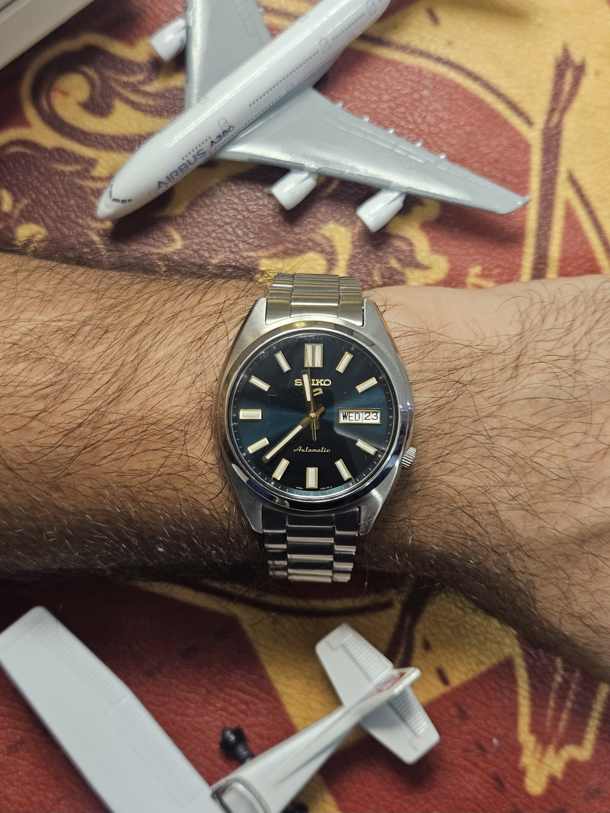
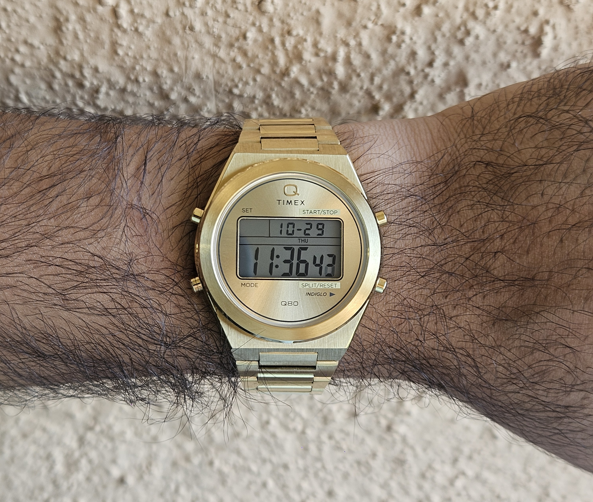
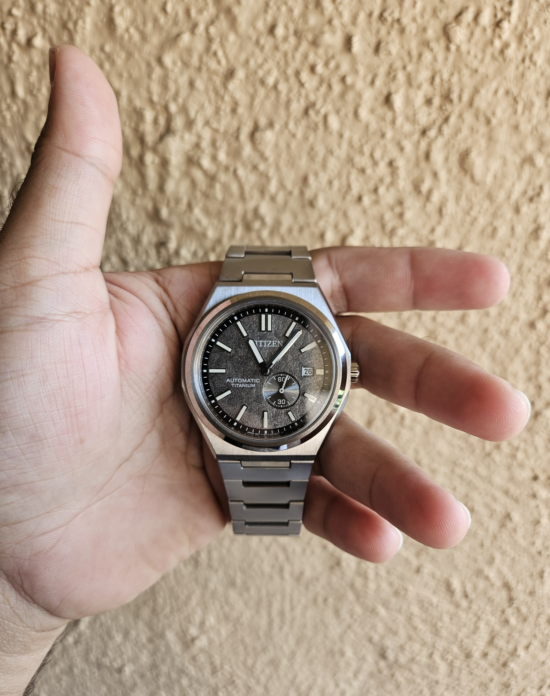

Sapphire crystal has become one of those specifications that watch enthusiasts absolutely love. Find a watch with sapphire at ₹10,000 and everyone is impressed. Find a ₹40,000 watch with mineral glass and suddenly the manufacturer has committed an unforgivable crime.

And honestly, I understand why. When you're spending a decent amount of money on a watch, having a crystal that resists scratches is a very attractive proposition. Nobody particularly enjoys looking down at their favourite dial through a collection of tiny scratches. But somewhere along the way, sapphire has become almost a requirement for a watch to be considered good, regardless of everything else it offers.

There are watches with Hardlex that look absolutely beautiful, inexpensive watches with mineral glass that make excellent everyday companions, and sapphire-equipped watches that somehow manage to reflect every light source in the room. So how much does the crystal actually matter, what exactly is Seiko's Hardlex, and when should you insist on sapphire?

## The Different Types of Watch Crystal

First, a quick clarification. When watchmakers talk about the crystal, they're referring to the transparent covering that protects the dial and hands. It doesn't necessarily mean the material is an actual mineral crystal. The industry uses the term for everything from plastic to synthetic sapphire.

There are four common materials worth knowing about.

| Crystal | Main advantage | Main compromise |
| --- | --- | --- |
| Sapphire | Excellent scratch resistance | Higher cost, can chip or crack |
| Hardlex | Seiko's strengthened mineral glass | Less scratch-resistant than sapphire |
| Mineral glass | Affordable and practical | Scratches relatively easily |
| Acrylic | Lightweight and can be polished | Scratches very easily |

On paper, sapphire appears to be the obvious winner. And when it comes to scratch resistance, it generally is. But the differences become more interesting when we look at how these materials behave in actual watches.

## Sapphire Crystal: Why Everyone Loves It

Sapphire crystal is made from synthetic crystalline aluminium oxide, essentially the same material as natural sapphire but manufactured for industrial use. It scores 9 on the Mohs hardness scale, making it one of the hardest materials commonly used in watchmaking.

For comparison, ordinary mineral glass is considerably softer, generally around 5 to 6 on the same scale. The Mohs scale measures relative resistance to scratching rather than overall durability, and the numbers aren't evenly spaced, but the difference is still significant.

In practical terms, sapphire is extremely resistant to the scratches that accumulate through everyday use. Contact with rough surfaces, dust containing abrasive particles and other everyday hazards is far less likely to leave permanent marks than it would on ordinary mineral glass. Considering how frequently our watches encounter desks, walls, doorframes and whatever else we manage to walk into, that is a genuinely useful advantage.

But scratch-resistant does not mean scratchproof. Materials hard enough to scratch sapphire do exist, and a sufficiently strong impact can still chip or fracture it. Sapphire is excellent at resisting abrasion, but it isn't an indestructible transparent shield.

Still, for somebody who wears the same watch regularly and wants the crystal to remain looking clean over several years, sapphire is difficult to argue against.

## What Exactly Is Seiko's Hardlex?

Hardlex is probably the most debated watch crystal among enthusiasts, largely because Seiko continues to use it on watches that aren't particularly inexpensive.

Despite the somewhat exotic name, Hardlex isn't a different form of sapphire. It is Seiko's proprietary strengthened mineral glass, used across several collections including many Seiko 5 Sports models. It is intended to offer a practical balance of durability, scratch resistance and manufacturing cost.

Hardlex is generally regarded as more scratch-resistant than basic mineral glass, although the exact manufacturing treatment and hardness aren't comprehensively specified in Seiko's public documentation. What we can say confidently is that it doesn't offer sapphire's level of scratch resistance.

And this brings us to the main complaint enthusiasts have with Hardlex: its price justification.

My [Seiko SRPL57K1](/blog/seiko-srpl57k1-review/) has a curved Hardlex crystal and an Indian MRP of ₹40,000. At that price, I absolutely think it is fair to expect sapphire, particularly when competing watches offer it. Seiko isn't selling us a ₹5,000 beater here, and at ₹40,000, compromises deserve a little more scrutiny.

That said, I wouldn't automatically dismiss Hardlex either. Its usefulness depends on the complete crystal construction and the watch surrounding it. A well-shaped, properly fitted Hardlex crystal can still be a lovely part of a watch, even if the material itself is less impressive on a specification sheet.

*The curved Hardlex on my Seiko SRPL57K1 complements the watch's rounded case.*

## Mineral Glass and Acrylic: Are They Really That Bad?

Ordinary mineral glass is common across affordable watches, and for good reason. It is relatively inexpensive to produce, provides good optical clarity and offers reasonable durability for normal everyday wear. Its biggest disadvantage is that scratches are easier to pick up, particularly when the crystal comes into contact with abrasive materials.

The frustrating part is that once a deep scratch develops, it can be difficult to ignore. Scratches are often more visible when light catches them at certain angles, particularly against darker dials. And of course, your eyes will somehow find that one scratch every time you look at the watch, even after you've spent several days convincing yourself that it doesn't matter.

But mineral glass can make perfect sense on a budget watch. Take the [Timex Q80](/blog/timex-q80-review/), which uses mineral glass. Its appeal comes from the distinctive retro design, excellent finishing and surprisingly good bracelet. With the gold version having dropped below ₹4,500 during Flipkart's Big Billion Days sale, expecting every premium specification would be rather unreasonable. That was a historical sale price, not a current offer.

Then there's acrylic, which deserves a mention because it remains popular on certain vintage and retro-inspired watches. Acrylic scratches very easily, often more easily than mineral glass, but many surface marks can be polished out using suitable products. It is lightweight, can produce lovely domed shapes and has a particular visual warmth that suits older designs.

Acrylic isn't necessarily the best material for someone who wants a crystal that stays pristine with minimal attention. But on the right watch, it can be part of the charm rather than an unfortunate cost-cutting measure.

## Scratch Resistance and Impact Resistance Are Not the Same Thing

This is probably the biggest misconception surrounding watch crystals.

A material's hardness tells you how well it resists scratching. It doesn't automatically tell you how well it survives being dropped, struck or subjected to sudden force. That involves other properties, including fracture toughness, elasticity, thickness, shape and how the crystal is mounted inside the case.

Sapphire is extremely hard, but it can fracture under a sufficiently severe impact. Mineral glass can have advantages in certain impact situations because of its mechanical properties, although it can also chip, crack or shatter. Neither material has a universal guarantee of surviving every possible impact better than the other.

[Citizen notes that mineral crystal has more flexibility than sapphire](https://support.citizenwatch.com/hc/en-us/articles/16494322181783-What-is-the-difference-between-mineral-crystal-vs-sapphire-crystal), which helps explain why different manufacturers choose different materials for particular watches. That doesn't mean every mineral-glass watch is tougher than every sapphire-equipped one. It simply demonstrates that crystal selection involves more than one property.

The construction matters enormously too. A thick crystal protected by a raised bezel is in a very different situation from a thin crystal sitting exposed above the case. The supporting gasket, crystal geometry and direction of the impact all affect how the assembly behaves.

This is also why I wouldn't use a hardness rating alone to judge whether a watch is suitable for rough outdoor use. Scratch resistance is important, but so is how the rest of the watch has been engineered.

## Why Some Sapphire Crystals Are Surprisingly Reflective

Now we get to something that doesn't receive nearly enough attention: how the crystal actually looks.

Sapphire is a wonderful material, but an uncoated sapphire crystal can be quite reflective. Depending on the lighting, you might find yourself looking at reflections of the sky, ceiling lights or your own face instead of the dial underneath.

This is where anti-reflective coating, commonly called AR coating, becomes important. An AR coating reduces reflections from the crystal's surfaces, helping improve dial visibility. Manufacturers can apply it to the underside of the crystal, the outer surface or both.

An internal coating is protected by the sapphire above it, while an external coating can reduce reflections further but remains exposed to everyday wear. And here's the slightly irritating part: an outer AR coating can develop scratches even when the sapphire underneath remains undamaged.

So you can have an exceptionally scratch-resistant sapphire crystal with visible marks on its coating. Wonderful.

This isn't a reason to avoid AR coatings. A well-executed coating can make an enormous difference, particularly on watches with dark dials or highly reflective surfaces. It simply means that the word "sapphire" doesn't tell you everything about the viewing experience.

The shape matters too. Flat, curved, domed and box-shaped crystals all interact with light differently. A beautifully domed crystal can add vintage character and interesting distortion around the edges, while a flatter design might suit a more modern, functional watch. There is a difference between technical clarity and visual appeal, and both have their place.

## My Seiko and Citizen Are Good Examples of This

Two watches I've reviewed illustrate why I find this topic particularly interesting.

The Seiko SRPL57K1 uses curved Hardlex, while the [Citizen Zenshin NJ0180-80H](/blog/citizen-zenshin-nj0180-80h-review/) comes with sapphire crystal. The Citizen has the clear technical advantage in scratch resistance, but my experience with the two watches was quite different.

I absolutely loved the Seiko's emerald-green dial, gold accents and rounded case. Its curved Hardlex crystal suited the design beautifully, and I found the dial clear and attractive throughout my time with the watch. I would still have preferred sapphire at its asking price, but the crystal didn't make the Seiko feel cheap or unpleasant to wear.

The Citizen, meanwhile, impressed me with its specifications, particularly the sapphire crystal and lightweight titanium construction. However, I had more mixed feelings about the watch itself. Its textured grey dial looked fantastic in sunlight but became considerably less interesting under ordinary indoor lighting.

Now, that doesn't mean Hardlex looks better than sapphire, or that the Seiko has superior optical performance. I haven't conducted controlled tests of the crystals, and the watches have very different dials and designs. What it does illustrate is how differently two complete watches can make you feel, even when one has a clear advantage in materials.

The Seiko's crystal is a specification I would criticise, but it hasn't stopped me from appreciating the watch. The Citizen's sapphire is an advantage I genuinely value, even though I wasn't quite as enthusiastic about the overall ownership experience.

## Can You Replace Hardlex or Mineral Glass With Sapphire?

One argument I often see is that you can simply replace a watch's mineral or Hardlex crystal with sapphire later.

And yes, that's possible on certain watches. Aftermarket sapphire crystals are available for a number of popular models, particularly Seikos. However, it isn't necessarily a straightforward upgrade.

The replacement must fit the case properly, including the diameter, thickness, shape and gasket arrangement. A crystal with the wrong dimensions can create sealing problems, affect hand clearance or simply fail to fit correctly. Replacing it can also disturb the original water-resistant seal, making correct installation and pressure testing particularly important for watches intended for swimming or diving.

In India, availability introduces another complication. A local watchmaker might be comfortable performing the installation, but finding a genuinely compatible, good-quality sapphire crystal for a particular reference isn't always guaranteed. The total cost can also vary considerably depending on the crystal and the work involved.

If you're considering an upgrade, I'd recommend checking compatibility, total cost, warranty implications and pressure-testing arrangements beforehand. I certainly wouldn't buy an expensive watch assuming that replacing the crystal later will be easy.

## So, Is Sapphire Worth Paying Extra For in India?

For most people buying an everyday watch, I think sapphire is absolutely worth having. Scratch resistance is a practical advantage, particularly when you wear the same watch regularly and want it to remain looking good for years.

If two watches are similarly priced, equally appealing and broadly comparable in quality, I would almost certainly choose the one with sapphire. But watches are rarely that equal, and the importance of the crystal changes considerably with the budget.

At ₹3,000 or ₹5,000, I'm perfectly happy accepting mineral glass if the watch offers good design, reliability and value. Around ₹10,000 to ₹20,000, sapphire becomes a more meaningful advantage, especially when competitors offer it without obvious compromises elsewhere.

By ₹40,000 and above, I become considerably more critical of manufacturers using mineral glass or Hardlex, unless there's a convincing reason for the choice. At those prices, sapphire is common enough that its absence deserves scrutiny. That's particularly relevant when comparing watches at their Indian MRPs rather than the discounted prices enthusiasts sometimes manage to find.

These aren't strict price rules, of course. A watch with Hardlex might become considerably more appealing at a substantial discount, while a sapphire-equipped watch can still be poor value if the bracelet, case finishing or movement leaves too much to be desired.

We've discussed this broader idea in [What Makes a Watch Actually Good?](/blog/what-makes-a-good-watch/), and crystal selection is a perfect example of why individual specifications need context.

## The Verdict

If I had to choose one crystal material for an everyday watch without knowing anything else about it, I would choose sapphire. Its scratch resistance is excellent, and for something that spends years exposed on your wrist, that's a benefit I genuinely value.

But Hardlex, mineral glass and even acrylic still have their place. A ₹5,000 watch with mineral glass can offer excellent value, while a ₹40,000 Seiko with Hardlex deserves some criticism even if the watch itself is beautiful. What matters is whether the crystal makes sense for the watch, its price and how you intend to use it.

I would love to see sapphire become standard across more affordable and mid-range watches, particularly in India where buyers have plenty of competing options. There is no reason to pretend Hardlex offers the same scratch resistance when it clearly doesn't, but there is equally little reason to dismiss a watch you genuinely love because of one material choice.

After all, the crystal is supposed to help you appreciate the dial underneath. It would be a shame to become so obsessed with the glass that we forget to look at the watch.
